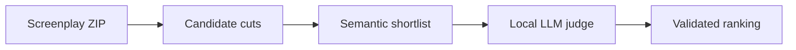

# Kuku Promo Finder

**Turn timestamped microdrama screenplays into ranked promo cuts.**

I built this for **Kuku’s AI Generalist Assignment · Problem 1, Find the Promos**. It proposes 20–60 second cuts and gives editors exact timestamps, the opening hook, the question left unresolved, and a short reason to consider each cut.

[Top promo](#top-promo) · [How it works](#how-it-works) · [Run locally](#run-locally) · [Evaluation](#evaluation)

| Episodes processed | Candidate windows | Ranked promos | Final validation failures |
| ---: | ---: | ---: | ---: |
| **50** | **4,265** | **139** across 47 episodes | **0** |

## Top promo

> **Episode 15 · `00:03.600 → 00:44.000` · 40.4 seconds · 9/9 model score**
>
> A thug smashes a planter within the opening three seconds. Juliana confronts the thugs just before the cut, leaving the viewer wondering whether they’ll back down.

I’d post this cut first because the conflict is clear even to someone who hasn’t watched the episode. The local judge scored it **3/3** on each criterion: hook, standalone clarity, and cliffhanger.

## How it works



1. **Parse and generate.** Python extracts dialogue and visual events with millisecond timestamps and stable event IDs. It builds continuous 20–60 second windows whose boundaries avoid splitting dialogue.
2. **Retrieve.** `all-MiniLM-L6-v2` embeds screenplay events. The pipeline averages the event embeddings in each window and uses cosine similarity against promo themes such as betrayal and identity reveal. It filters overlapping cuts and shortlists up to six per episode.
3. **Judge with retrieved evidence.** Qwen2.5 3B runs locally through Ollama. It receives the shortlisted screenplay events and their IDs, then returns structured scores, cited events, a reason, and a keep, refine, or reject decision.
4. **Validate and rank.** Python requires a complete opening event within the first three seconds, validates cited IDs and scores, and retries an invalid model response once. It ranks qualifying clips by total score, then by hook score.

**Stack** · Python, NumPy, Sentence Transformers, Ollama, Qwen2.5 3B

## Run locally

Install Python and start Ollama. Run these commands from the repository root in **Windows Command Prompt**.

```bat
python -m venv .venv
.venv\Scripts\activate
python -m pip install -r requirements.txt
ollama pull qwen2.5:3b
```

Create `.env` in the repository root.

```dotenv
LLM_PROVIDER=ollama
LLM_MODEL=qwen2.5:3b
```

Place the supplied timestamped screenplay archive at `data\screenplays.zip`, then run:

```bat
python main.py data\screenplays.zip
python windows.py
python retrieval.py
python judge.py --all
```

| Output | What to look for |
| --- | --- |
| `outputs/ranked.csv` | Episode, start and end timestamps, hook, cliffhanger question, scores, and reason |
| `outputs/judge_attempts.jsonl` | Per-clip judge decisions and validation attempts |

Use the supplied screenplay archive locally. Full-run outputs are available through the separate assignment submission link.

## Evaluation

The full run parsed **3,727 events** and shortlisted **214 windows**. The opening screen removed **67**, leaving **147** successfully judged. Of those, **139** were ranked and **8** were flagged for refinement.

I also compared all windows against the shortlist on Episodes 1, 26, and 50 using three manually reviewed, AI-assisted reference cuts.

| Three-episode diagnostic | All windows | Retrieval shortlist |
| --- | ---: | ---: |
| Candidates before the opening screen | 194 | 11 |
| Windows judged successfully | 120 | 4 |
| Reference picks matched after screening | 2/3 | 1/3 |
| Reference picks matched among kept clips | 2/3 | 0/3 |

Retrieval reduced the number of judged windows by **96.7%** on this sample, while reducing coverage of the reference picks. With three references, this is a diagnostic result.

### Where it fails

- **A valid timestamp can still make a weak hook.** In Episode 22, the judge gave a quiet door-handle turn **3/3**. The event passed the timing rule, but offers little immediate action on the page.
- **The opening screen can miss a useful beat.** A visual action can start strongly and still be excluded if it finishes after three seconds.
- **Refinement can add work without improving a cut.** In Episode 1, three alternatives took three extra model requests. The best tied the original at **7/9**, so I kept the original.

The ranking is based on the screenplay. An editor makes the final call after checking the footage.

### Scaling across shows

Process episodes in batches, reuse cached judgments for identical inputs, and widen retrieval when a show produces too few useful candidates. Editors can focus their footage review on the highest-ranked cuts.
